# 資料庫 v2：ERD 與逐欄說明

狀態：已在本機 PostgreSQL 相容環境執行驗證，尚未套用遠端 Supabase。11 張業務資料表、133 個欄位。更新方式見 `supabase/README.md`。

不含 Supabase 自行管理的 auth／storage 內部全表；操作者 UUID 參照 auth.users.id，物件路徑指向私有 Storage，不是 SQL 外鍵。

```mermaid
erDiagram
    patients ||--o{ examinations : patient_id
    patients ||--o| patient_notes : patient_id
    examinations ||--o{ analysis_records : examination_id
    analysis_records ||--o| reports : analysis_record_id
    reports ||--o{ report_versions : report_id
    report_versions ||--o| report_reviews : report_version_id
    report_versions ||--o{ report_exports : report_version_id
    patients ||--o{ email_drafts : patient_id
    report_versions o|--o{ email_drafts : report_version_id
    email_drafts ||--o{ email_deliveries : draft_id
    patients ||--o{ email_deliveries : patient_id
    report_versions o|--o{ email_deliveries : report_version_id
    report_exports o|--o{ email_deliveries : report_export_id
    email_deliveries ||--o{ email_delivery_events : delivery_id
    patients {
        uuid id PK
        text patient_code
        text patient_name
        text national_id
        date birth_date
        text sex
        text phone
        text health_card_number
        text patient_data_source
        text identity_status
        uuid created_by
        timestamptz created_at
        timestamptz updated_at
        text email
    }
    examinations {
        uuid id PK
        text examination_code
        uuid patient_id
        text sample_id
        boolean include_motility
        text template_label
        uuid created_by
        timestamptz created_at
        timestamptz collected_at
    }
    analysis_records {
        uuid id PK
        uuid examination_id
        text sample_id
        date exam_date
        text clinical_status
        text processing_state
        numeric density
        numeric motility
        numeric morphology
        text summary
        jsonb ai_result
        jsonb boxes
        text original_image_path
        text analyzed_image_path
        uuid created_by
        timestamptz created_at
        timestamptz updated_at
        numeric amount
        text amount_unit
        text color
        text appearance
        numeric ph
        numeric count_of_spermatozoa
        text count_unit
        text count_definition
        text density_unit
        text motility_type
        jsonb measurement_status
        jsonb interpretation
        text interpretation_version
        jsonb legacy_metrics
        uuid reviewed_by
        timestamptz reviewed_at
        text review_note
    }
    patient_notes {
        uuid patient_id PK
        text note
        uuid updated_by
        timestamptz updated_at
    }
    reports {
        uuid id PK
        uuid analysis_record_id
        uuid created_by
        timestamptz created_at
    }
    report_versions {
        uuid id PK
        uuid report_id
        integer version
        text title
        text summary
        text conclusion
        text recommendations
        jsonb patient_snapshot
        jsonb measurements_snapshot
        jsonb interpretation_snapshot
        text language
        text change_note
        uuid created_by
        timestamptz created_at
    }
    report_reviews {
        uuid id PK
        uuid report_version_id
        uuid reviewed_by
        timestamptz reviewed_at
        text note
    }
    report_exports {
        uuid id PK
        uuid report_version_id
        text file_path
        text file_sha256
        uuid created_by
        timestamptz created_at
    }
    email_drafts {
        uuid id PK
        uuid patient_id
        uuid report_version_id
        text to_email
        text subject
        text body
        text language
        integer revision
        uuid created_by
        uuid updated_by
        timestamptz created_at
        timestamptz updated_at
    }
    email_deliveries {
        uuid id PK
        uuid draft_id
        integer draft_revision
        uuid patient_id
        uuid report_version_id
        text to_email
        text subject
        text body
        text language
        boolean attach_report
        uuid report_export_id
        uuid idempotency_key
        text status
        text provider
        text provider_message_id
        integer attempt_count
        uuid requested_by
        timestamptz requested_at
        timestamptz accepted_at
        timestamptz delivered_at
        timestamptz last_attempt_at
        text error_code
        timestamptz updated_at
    }
    email_delivery_events {
        uuid id PK
        uuid delivery_id
        text provider
        text provider_event_id
        text event_type
        timestamptz occurred_at
        timestamptz received_at
        jsonb details
    }
```

## patients：病患主檔與預設聯絡方式

- **id** — `uuid`；必填；預設 `gen_random_uuid()`。本表 UUID 主鍵，自動產生。
- **patient_code** — `text`；必填；預設 `無`。唯一病患代碼。
- **patient_name** — `text`；必填；預設 `無`。病患姓名。
- **national_id** — `text`；必填；預設 `無`。身分證號或病歷識別碼；目前未設唯一約束。
- **birth_date** — `date`；必填；預設 `無`。出生日期；年齡由程式計算。
- **sex** — `text`；必填；預設 `無`。M／F／UNKNOWN。
- **phone** — `text`；可空；預設 `無`。聯絡電話，選填。
- **health_card_number** — `text`；可空；預設 `無`。健保卡號，選填。
- **patient_data_source** — `text`；必填；預設 `無`。health_card／manual，資料取得方式。
- **identity_status** — `text`；可空；預設 `無`。身分註記，選填。
- **created_by** — `uuid`；可空；預設 `無`。建立操作人員的 auth.users.id。
- **created_at** — `timestamp with time zone`；必填；預設 `now()`。建立時間（含時區）。
- **updated_at** — `timestamp with time zone`；必填；預設 `now()`。最後修改時間；有對應觸發器的表由資料庫自動更新。
- **email** — `text`；可空；預設 `無`。病患預設 Email，選填；實際寄件仍保存獨立收件地址。

## examinations：某位病患的一次檢測／檢體

- **id** — `uuid`；必填；預設 `gen_random_uuid()`。本表 UUID 主鍵，自動產生。
- **examination_code** — `text`；必填；預設 `無`。唯一檢測代碼。
- **patient_id** — `uuid`；必填；預設 `無`。對應 patients.id 的病患外鍵。
- **sample_id** — `text`；必填；預設 `無`。檢體編號，非病患 ID。
- **include_motility** — `boolean`；必填；預設 `false`。本次是否選擇活動力分析，預設 false。
- **template_label** — `text`；可空；預設 `無`。所選示範範本名稱，選填。
- **created_by** — `uuid`；可空；預設 `無`。建立操作人員的 auth.users.id。
- **created_at** — `timestamp with time zone`；必填；預設 `now()`。建立時間（含時區）。
- **collected_at** — `timestamp with time zone`；可空；預設 `無`。實際檢體採樣時間，未知時 null；不同於資料建立時間。

## analysis_records：量測、分析結果與兩張影像路徑

- **id** — `uuid`；必填；預設 `gen_random_uuid()`。本表 UUID 主鍵，自動產生。
- **examination_id** — `uuid`；必填；預設 `無`。對應 examinations.id。一次檢測可有多筆分析紀錄。
- **sample_id** — `text`；必填；預設 `無`。檢體編號，非病患 ID。
- **exam_date** — `date`；必填；預設 `CURRENT_DATE`。檢驗日期。
- **clinical_status** — `text`；可空；預設 `無`。整體判讀／示範標籤；不是工作流程狀態。
- **processing_state** — `text`；必填；預設 `'待複核'::text`。待複核／已完成／影像待上傳等工作流程狀態，沿用既有文字。
- **density** — `numeric`；可空；預設 `無`。濃度，numeric；舊文字已轉換。不代表獨立的 Count。
- **motility** — `numeric`；可空；預設 `無`。Excel Motility：活動力百分比數值 0–100，DB 不存 % 字元；活動力定義見 motility_type。
- **morphology** — `numeric`；可空；預設 `無`。Excel Morphology：正常型態比例數值 0–100，DB 不存 % 字元；不是頭身比。
- **summary** — `text`；可空；預設 `無`。分析摘要；報告修改另存版本，不覆寫此原始摘要。
- **ai_result** — `jsonb`；可空；預設 `無`。原始／示範分析 JSON；isDemo 為示範標記。正式顯示數值以 numeric 欄為準。
- **boxes** — `jsonb`；可空；預設 `無`。原圖座標的標記框 JSON；沿用前端百分比座標格式。
- **original_image_path** — `text`；可空；預設 `無`。私有 exam-images 的原始影像物件路徑，不存簽名 URL。
- **analyzed_image_path** — `text`；可空；預設 `無`。私有 exam-images 的分析後標記影像路徑；未生成則 null。
- **created_by** — `uuid`；可空；預設 `無`。建立操作人員的 auth.users.id。
- **created_at** — `timestamp with time zone`；必填；預設 `now()`。建立時間（含時區）。
- **updated_at** — `timestamp with time zone`；必填；預設 `now()`。最後修改時間；有對應觸發器的表由資料庫自動更新。
- **amount** — `numeric`；可空；預設 `無`。Excel Amount，numeric；實際定義及單位待後端定案，未測為 null。
- **amount_unit** — `text`；可空；預設 `無`。Amount 的單位代碼；未定不預設。
- **color** — `text`；可空；預設 `無`。Excel Color，顏色描述／穩定代碼；文字，不是量測數字。
- **appearance** — `text`；可空；預設 `無`。Excel Appearance，外觀描述／穩定代碼；文字。
- **ph** — `numeric`；可空；預設 `無`。Excel pH，numeric，0–14 為結構範圍；未測 null。
- **count_of_spermatozoa** — `numeric`；可空；預設 `無`。Excel Count of spermatozoa，numeric；單位／總數或計數定義尚未定案，不與 density 混用。
- **count_unit** — `text`；可空；預設 `無`。Count 的單位代碼，未定 null。
- **count_definition** — `text`；可空；預設 `無`。Count 的計數定義／基準，由後端確定。
- **density_unit** — `text`；可空；預設 `無`。濃度單位；既有程式使用 million/mL。
- **motility_type** — `text`；可空；預設 `無`。活動力分類定義，例如後端定案的 total／progressive；未知 null。
- **measurement_status** — `jsonb`；必填；預設 `'{}'::jsonb`。各量測的狀態 JSON，例如未檢測／失敗／完成；沒有填寫不推論為零。
- **interpretation** — `jsonb`；必填；預設 `'{}'::jsonb`。後端產生的各指標判讀／參考範圍 JSON；不預設門檻。
- **interpretation_version** — `text`；可空；預設 `無`。上述判讀規則版本，由後端填。
- **legacy_metrics** — `jsonb`；可空；預設 `無`。遷移前 density／motility／morphology 原始文字備存；重跑不覆蓋。
- **reviewed_by** — `uuid`；可空；預設 `無`。審核操作者 auth.users.id，不等同已驗證醫師資格。
- **reviewed_at** — `timestamp with time zone`；可空；預設 `無`。審核時間（含時區）。
- **review_note** — `text`；可空；預設 `無`。這次分析的審核意見；病患長期備註另外存。

## patient_notes：每位病患一筆長期備註

- **patient_id** — `uuid`；必填；預設 `無`。主鍵兼外鍵 patients.id；一位病患最多一筆長期備註。
- **note** — `text`；必填；預設 `''::text`。可更新的病患長期備註，不是每次檢驗的版本化審核意見。
- **updated_by** — `uuid`；可空；預設 `無`。最後修改操作人員的 auth.users.id。
- **updated_at** — `timestamp with time zone`；必填；預設 `now()`。最後修改時間；有對應觸發器的表由資料庫自動更新。

## reports：分析紀錄的報告身份

- **id** — `uuid`；必填；預設 `gen_random_uuid()`。本表 UUID 主鍵，自動產生。
- **analysis_record_id** — `uuid`；必填；預設 `無`。對應 analysis_records.id，唯一；每筆分析最多一份報告身份，各次修改存子表版本。
- **created_by** — `uuid`；必填；預設 `auth.uid()`。建立操作人員的 auth.users.id。
- **created_at** — `timestamp with time zone`；必填；預設 `now()`。建立時間（含時區）。

## report_versions：每次保存的不可覆寫報告版本

- **id** — `uuid`；必填；預設 `gen_random_uuid()`。本表 UUID 主鍵，自動產生。
- **report_id** — `uuid`；必填；預設 `無`。對應 reports.id。
- **version** — `integer`；必填；預設 `無`。同一報告從 1 遞增；與 report_id 組成唯一約束。
- **title** — `text`；必填；預設 `無`。可修改的報告標題。
- **summary** — `text`；必填；預設 `''::text`。可修改的報告摘要。
- **conclusion** — `text`；必填；預設 `''::text`。可修改的報告結論。
- **recommendations** — `text`；必填；預設 `''::text`。可修改的建議／衛教文字。
- **patient_snapshot** — `jsonb`；必填；預設 `無`。保存當時病患資訊，不隨後續病患修改而改寫；預設不含身分證／健保卡號。
- **measurements_snapshot** — `jsonb`；必填；預設 `無`。由 DB 從原分析複製的數值、單位、檢驗資訊及示範標記；前端不能傳入改量測值。
- **interpretation_snapshot** — `jsonb`；必填；預設 `'{}'::jsonb`。保存當時後端判讀結果與規則版本。
- **language** — `text`；必填；預設 `'zh'::text`。內容語言代碼；預設 zh，前端現有 zh／en／ko。
- **change_note** — `text`；必填；預設 `''::text`。這次改動的說明；透過兩版內容差異還原具體修改。
- **created_by** — `uuid`；必填；預設 `auth.uid()`。建立操作人員的 auth.users.id。
- **created_at** — `timestamp with time zone`；必填；預設 `now()`。建立時間（含時區）。

## report_reviews：精確對應某版的審核

- **id** — `uuid`；必填；預設 `gen_random_uuid()`。本表 UUID 主鍵，自動產生。
- **report_version_id** — `uuid`；必填；預設 `無`。唯一外鍵，每一版最多一筆確認審核；新版本不繼承。
- **reviewed_by** — `uuid`；必填；預設 `auth.uid()`。審核操作者 auth.users.id，不等同已驗證醫師資格。
- **reviewed_at** — `timestamp with time zone`；必填；預設 `now()`。審核時間（含時區）。
- **note** — `text`；必填；預設 `''::text`。這一版的審核意見；審核資料不可覆寫。

## report_exports：某版 PDF 的私有檔案

- **id** — `uuid`；必填；預設 `gen_random_uuid()`。本表 UUID 主鍵，自動產生。
- **report_version_id** — `uuid`；必填；預設 `無`。對應 report_versions.id，精確指定某一版報告。
- **file_path** — `text`；必填；預設 `無`。私有 reports bucket 的 PDF 物件路徑，唯一；由後端生成與上傳。
- **file_sha256** — `text`；必填；預設 `無`。PDF 檔案 SHA-256 十六進位摘要，64 位字元；供核對附件內容。
- **created_by** — `uuid`；必填；預設 `無`。建立操作人員的 auth.users.id。
- **created_at** — `timestamp with time zone`；必填；預設 `now()`。建立時間（含時區）。

## email_drafts：可編輯 Email 草稿

- **id** — `uuid`；必填；預設 `gen_random_uuid()`。本表 UUID 主鍵，自動產生。
- **patient_id** — `uuid`；必填；預設 `無`。對應 patients.id 的病患外鍵。
- **report_version_id** — `uuid`；可空；預設 `無`。對應 report_versions.id，精確指定某一版報告。
- **to_email** — `text`；必填；預設 `無`。收件 Email；草稿／寄送各自保存，不隨病患預設 Email 自動改寫。
- **subject** — `text`；必填；預設 `''::text`。Email 主旨。
- **body** — `text`；必填；預設 `''::text`。Email 內文。
- **language** — `text`；必填；預設 `'zh'::text`。內容語言代碼；預設 zh，前端現有 zh／en／ko。
- **revision** — `integer`；必填；預設 `1`。草稿修訂序號，新增 1，每次更新由 DB 遞增，供樂觀鎖定。
- **created_by** — `uuid`；必填；預設 `auth.uid()`。建立操作人員的 auth.users.id。
- **updated_by** — `uuid`；必填；預設 `auth.uid()`。最後修改操作人員的 auth.users.id。
- **created_at** — `timestamp with time zone`；必填；預設 `now()`。建立時間（含時區）。
- **updated_at** — `timestamp with time zone`；必填；預設 `now()`。最後修改時間；有對應觸發器的表由資料庫自動更新。

## email_deliveries：每次發送凍結內容與後端狀態

- **id** — `uuid`；必填；預設 `gen_random_uuid()`。本表 UUID 主鍵，自動產生。
- **draft_id** — `uuid`；必填；預設 `無`。來源 email_drafts.id。
- **draft_revision** — `integer`；必填；預設 `無`。排程當下草稿的 revision，之後草稿修改不影響此筆。
- **patient_id** — `uuid`；必填；預設 `無`。對應 patients.id 的病患外鍵。
- **report_version_id** — `uuid`；可空；預設 `無`。對應 report_versions.id，精確指定某一版報告。
- **to_email** — `text`；必填；預設 `無`。收件 Email；草稿／寄送各自保存，不隨病患預設 Email 自動改寫。
- **subject** — `text`；必填；預設 `無`。Email 主旨。
- **body** — `text`；必填；預設 `無`。Email 內文。
- **language** — `text`；必填；預設 `無`。內容語言代碼；預設 zh，前端現有 zh／en／ko。
- **attach_report** — `boolean`；必填；預設 `false`。是否附上指定版本報告 PDF；true 時 report_version_id 必填。
- **report_export_id** — `uuid`；可空；預設 `無`。實際附件對應 report_exports.id；排程時可空，後端生成附件後填入且必須符合報告版本。
- **idempotency_key** — `uuid`；必填；預設 `無`。本次發送請求的唯一 UUID；重試沿用，防止重複排程。
- **status** — `text`；必填；預設 `'queued'::text`。queued／sending／accepted／delivered／bounced／failed／unknown；只有後端可更新。
- **provider** — `text`；可空；預設 `無`。寄件供應商代碼。
- **provider_message_id** — `text`；可空；預設 `無`。供應商郵件 ID，與 provider 組成部分唯一索引。
- **attempt_count** — `integer`；必填；預設 `0`。實際嘗試次數，初始 0；後端累加。
- **requested_by** — `uuid`；必填；預設 `無`。發送請求人的 auth.users.id，由排程 RPC 設定。
- **requested_at** — `timestamp with time zone`；必填；預設 `now()`。建立發送請求時間，不等於寄出時間。
- **accepted_at** — `timestamp with time zone`；可空；預設 `無`。供應商接受郵件的時間，不代表送達。
- **delivered_at** — `timestamp with time zone`；可空；預設 `無`。由已驗證供應商事件確認的送達時間。
- **last_attempt_at** — `timestamp with time zone`；可空；預設 `無`。最後嘗試寄件的時間。
- **error_code** — `text`；可空；預設 `無`。後端／供應商錯誤碼，避免存憑證或完整敏感除錯資料。
- **updated_at** — `timestamp with time zone`；必填；預設 `now()`。最後修改時間；有對應觸發器的表由資料庫自動更新。

## email_delivery_events：供應商事件歷程

- **id** — `uuid`；必填；預設 `gen_random_uuid()`。本表 UUID 主鍵，自動產生。
- **delivery_id** — `uuid`；必填；預設 `無`。對應 email_deliveries.id。
- **provider** — `text`；必填；預設 `無`。回報事件的寄件供應商。
- **provider_event_id** — `text`；必填；預設 `無`。供應商事件識別碼，與 provider 唯一；攔截 webhook 重複事件。
- **event_type** — `text`；必填；預設 `無`。queued／sending／accepted／delivered／bounced／failed／unknown。
- **occurred_at** — `timestamp with time zone`；必填；預設 `無`。供應商事件實際發生時間。
- **received_at** — `timestamp with time zone`；必填；預設 `now()`。系統接收事件時間；可與發生時間不同。
- **details** — `jsonb`；必填；預設 `'{}'::jsonb`。必要且已過濾的供應商事件細節 JSON，不存驗證密鑰。

