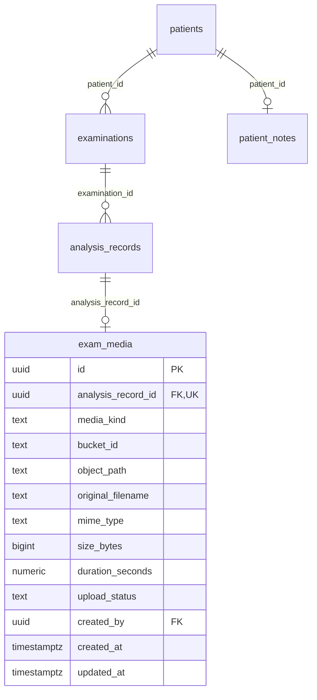

# 病患選取與單檔影片儲存

2026-10-19。新版程式已實作，但遠端必須先執行 `supabase/migrations/202610190002_exam_media.sql` 才能部署。本次不自動修改 Supabase，不搬移或刪除既有檔案。

## 設定與容量

- 一次一個檔案：新選照片／影片會取代尚未上傳的選取；不批次上傳。
- 照片 JPEG／PNG／WebP，最大 10 MiB（畫面簡寫 10 MB），仍存 private exam-images。
- 影片最大 50,000,000 bytes（十進位 50 MB），另存 private exam-videos。接受 video/* MIME，以及 MIME 缺漏時可辨識的 MP4、MOV、M4V、WebM、AVI、MKV、MPEG、3GP、WMV、FLV、TS、MTS、M2TS、OGV 等副檔名。
- 不是保證所有格式或編碼都能在瀏覽器播放；無法辨識的格式請先轉 MP4。影片只保存由使用者選取的測試副本，不會自動壓縮、轉檔、抽格、辨識或計算活動力。原始影片由使用者自行保留本機，系統不保存本機路徑。壓縮／縮短副本不能直接視為與原片有相同的未來分析結果。ai_result.isTestCopy=true 記錄這個開發用途。不能播放仍可取得短效連結開啟／下載原檔。
- Supabase 免費方案目前為 1 GB 檔案儲存、單檔上限 50 MB；應用程式限制 50 MB 是為了控制容量。每支接近 50 MB 上限時約二十支就可能接近總容量，尚未扣除照片／標記圖／PDF；請預留空間。這不是每月新增可永久累積的 1 GB。
- 檢查真實容量請用 Supabase Usage／Storage 的用量數據。沒有自動刪除策略，也不會因容量不足偷偷刪舊檔案；容量不足由上傳錯誤回報。
- Global file size limit 至少要允許 50,000,000 bytes。新 SQL 的 bucket 限制無法超越專案的全域限制。
- 現在使用 TUS 分段上傳（每段 6 MiB）及 direct Storage hostname，顯示實際已傳 bytes／百分比。取消／失敗後只要停留原頁且保留同一檔案，就可沿用記憶體中的上傳 URL 續傳，不寫到 localStorage。重新整理後不保證續傳；不自動刪除雲端物件。資料請求每步 30 秒逾時；上傳連續 90 秒沒有進度停止，有進度則繼續，整次上傳最多 30 分鐘。傳送到 100% 後仍需伺服器確認與最後 DB 更新才宣告成功。

來源：[方案容量](https://supabase.com/pricing)、[檔案限制](https://supabase.com/docs/guides/storage/uploads/file-limits)、[標準／可續傳上傳](https://supabase.com/docs/guides/storage/uploads/standard-uploads)。

## 病患流程

1. 在影像分析頁搜尋至少 2 字，依姓名、病患代碼、身分證／病歷識別碼查找，分頁載入每頁 20 筆。
2. 選病患後讀取主檔、病患備註、最近五筆分析及摘要，載入失敗會顯示錯誤，不會誤當成「沒有歷史」。沒有過往分析的已建檔病患也能選。
3. 按下確認後才顯示檢體與檔案設定。選既有病患時依 patients.id 關聯，不覆寫病患主檔。
4. 新增病患保留手動及健保卡讀取；確認資料時尚未寫入資料庫。真正按下開始時才建立。若 national_id 已存在，要求改用搜尋選取，避免用新增入口覆寫病患。
5. 第一次嘗試寫入後如已保存部分內容，鎖定病患／檔案及本次設定，留在原頁重試；不刪除已寫入內容。重新整理不會保留尚未上傳的本機 File。
6. 照片／範本維持示範分析；影片同樣使用明確標記的示範結果，顯示完整分析頁並進入待複核。尚未接上真實分析模組。既有待分析紀錄不會自動改寫。

## Supabase 操作

1. 舊 20 MB 更新檔若已執行，可直接重跑這份最新版；尚未執行則照常第一次執行。確認前一份 v2 SQL 已套用（使用者已回報成功，11 表／133 欄）。
2. SQL Editor 新查詢，完整貼上並執行 `202610190002_exam_media.sql`。不用重跑第一份，也不改 exam-images 為公開。
3. 查詢確認：

```sql
select id, public, file_size_limit, allowed_mime_types
from storage.buckets where id in ('exam-images','exam-videos');
select column_name,data_type,is_nullable
from information_schema.columns
where table_schema='public' and table_name='exam_media'
order by ordinal_position;
```

4. 預期 exam-videos 為 private、50000000 bytes、video/*；exam_media 為 13 欄。已存在的舊版 20 MiB bucket／資料檢查會安全升為 50 MB；其他不明設定則停止，不會擅自改公開性或刪資料。
5. 在本機登入後做下方測試，確認後才推送／部署既有 Vercel 專案。

## 新表 exam_media 的逐欄字典

每筆分析最多一個原始檔案。原本兩個影像欄位保留，照片沿用原圖路徑；分析後圖仍由後端日後生成。舊影像不自動建立媒體 metadata。

- id：uuid，主鍵，預設 gen_random_uuid()；此版前端沿用分析紀錄 UUID 作為穩定媒體 ID。
- analysis_record_id：uuid，必填，唯一外鍵 analysis_records.id，防止同筆分析重複建原始檔案。
- media_kind：text，必填，image 或 video。
- bucket_id：text，必填，照片 exam-images、影片 exam-videos，資料庫檢查兩者配對。
- object_path：text，必填，私有物件路徑；與 bucket_id 唯一，不存簽名 URL。
- original_filename：text，必填，使用者原始檔名；Storage 物件名稱則使用 UUID，不包含病患姓名。
- mime_type：text，必填；照片限三種 MIME，影片為 video/*。
- size_bytes：bigint，必填，檔案大小（bytes）；照片最多 10 MiB、影片最多 50,000,000 bytes。
- duration_seconds：numeric，可空；預留後端讀取影片長度，現階段不解析，保持 null。
- upload_status：text，必填，pending 或 ready；真正上傳成功後才設 ready。
- created_by：uuid，必填，預設 auth.uid()，外鍵 auth.users.id；原檔 metadata 由上傳者建立／更新，已登入人員共用讀取。
- created_at：timestamptz，必填，預設 now()。
- updated_at：timestamptz，必填，觸發器自動維護。



Storage 的 bucket_id／object_path 是物件路徑，沒有 SQL 外鍵直接連到 storage.objects。新表啟用 RLS，anon 無權；影片 Storage 只有已登入者可讀、上傳者可寫自己的 UUID 目錄；沒有刪除權限或公開 URL。

## 本機與真實帳號驗收

- 搜尋已建檔病患（含沒有檢測的人）、查看備註／摘要，確認前不新增任何檢測；更換病患後重新確認。
- 新增入口填入既有識別碼，確認提示改用搜尋，不覆寫主檔。
- 選照片後再選影片，確保只有最後一個檔案；超過 50,000,000 bytes 的影片與超過 10 MiB 的照片在寫入前拒絕。
- 儲存影片後，重整仍可開啟私有影片；新紀錄為示範數值、狀態待複核，結果頁保留私有影片預覽。
- 斷線上傳時不顯示成功，原頁重試沿用原紀錄／物件；pending 紀錄不誤顯示為已完成。
- 不同編碼不能播放時有提示及短效原檔連結；不自動上傳舊本機資料。

## 上傳等候與重試

24 MB 若實際上傳約 3.2 Mbps，光傳輸約需 60 秒，並非一定卡死。進度視窗列出確認登入／儲存檢測／上傳／確認儲存等步驟及實際已傳 MB，可按取消；慢速但持續前進不會僅因一分鐘就中止。出錯時記錄畫面中的步驟與錯誤即可，不要貼登入 token 或簽名 URL。這次改動不需再執行資料庫 SQL。
